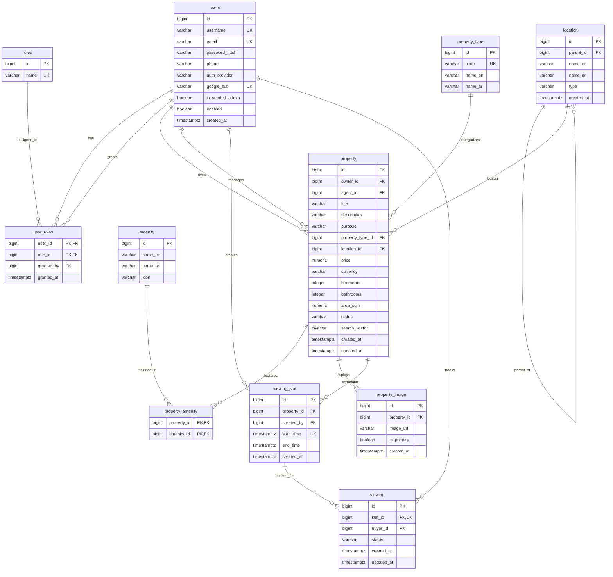

# Sakan Database Architecture & Entity-Relationship Diagram

This document describes the PostgreSQL database schema for the **Sakan** real-estate platform, managed via Flyway database migrations.

---

## 1. Entity-Relationship Diagram

The following Mermaid ER diagram models all core entities, their attributes, and relationships. Many-to-many relationships are represented via associative entities (`user_roles`, `property_amenity`), and the location hierarchy is modeled via an adjacency self-reference (`location.parent_id`).

---

## 2. Architectural & Design Decisions

The following key decisions highlight the rationale behind non-obvious schema choices:

- **VARCHAR with CHECK constraints instead of native PostgreSQL ENUMs:** PostgreSQL native `ENUM` types complicate automated Flyway migrations and zero-downtime releases because altering, adding, or renaming values requires custom `ALTER TYPE` commands or type recreation. `VARCHAR(n)` with `CHECK` constraints (e.g., `purpose IN ('SALE', 'RENT')`, `status`, `auth_provider`, and `currency`) provides type safety at the database level while allowing simple `ALTER TABLE ... DROP/ADD CONSTRAINT` migrations and seamless mapping to Java/TypeScript enums.
- **NUMERIC for monetary values paired with currency code:** Floating-point data types (`FLOAT`, `DOUBLE PRECISION`) suffer from binary representation and rounding inaccuracies unacceptable for financial values. `NUMERIC(14, 2)` guarantees exact decimal arithmetic (up to 12 digits for Egyptian real-estate prices with 2 fractional digits). Storing an explicit `currency VARCHAR(3)` code (e.g., `EGP`, `USD`) accommodates Egypt's multi-currency market without loss of exchange precision (FR-11).
- **Double-booking prevention via partial unique index on `viewing(slot_id)`:** To enforce that a slot can never be concurrently booked while preserving full historical records, a partial unique index is defined (`CREATE UNIQUE INDEX uq_viewing_active_slot ON viewing (slot_id) WHERE status IN ('REQUESTED', 'CONFIRMED')`). Cancelled, rejected, or completed appointments remain archived without blocking the slot from being re-requested or re-scheduled.
- **Unified self-referencing adjacency table for hierarchical locations:** Rather than maintaining four separate tables for governorates, cities, districts, and compounds, a single `location` table with a nullable `parent_id REFERENCES location(id)` models the recursive geographic hierarchy. This design facilitates recursive Common Table Expressions (CTEs), keeps indexing uniform, and supports cascading UI dropdowns effortlessly (FR-09, FR-10).
- **Inline bilingual columns (`name_en`, `name_ar`) for reference data:** Real-estate discovery in Egypt requires full English and Arabic (RTL) localization. Storing `name_en` and `name_ar` directly on reference entities (`location`, `property_type`, `amenity`) eliminates expensive join tables (such as translation tables), guarantees instant dual-language access, and streamlines full-text search indexing.
- **Associative entities for many-to-many relationships:** Relationships between `users` & `roles` (`user_roles`) and `property` & `amenity` (`property_amenity`) use dedicated associative entities with composite primary keys `(user_id, role_id)` and `(property_id, amenity_id)`. This enforces referential integrity at the database level, enables efficient bidirectional index lookups, and accommodates join metadata (such as `granted_by` and `granted_at` on `user_roles`).
- **Slot integrity and overlap detection index:** In `viewing_slot`, a composite unique constraint `(property_id, start_time)` prevents duplicate start windows, a `CHECK (end_time > start_time)` ensures chronological integrity, and a composite index on `(property_id, start_time, end_time)` accelerates interval overlap queries (`start_time < :end AND end_time > :start`).
- **Generated TSVECTOR and GIN indexing for bilingual search:** The `property` table maintains a generated `search_vector tsvector` (`STORED`) weighting titles and descriptions with a GIN index, alongside `pg_trgm` trigram indexing on `title`. This enables fast Arabic and English keyword and similarity matching within PostgreSQL without external indexing services.
- **Soft lifecycle and archival strategies:** Data retention rules prioritize status updates (`ARCHIVED`, `CANCELLED`) over destructive hard deletes (NFR-08). Cascades (`ON DELETE CASCADE`) are restricted to tightly owned private dependencies (`property_amenity`, `viewing_slot`, `property_image`), whereas user references use `ON DELETE SET NULL` on audit columns (`granted_by`) to ensure historical traceability.
